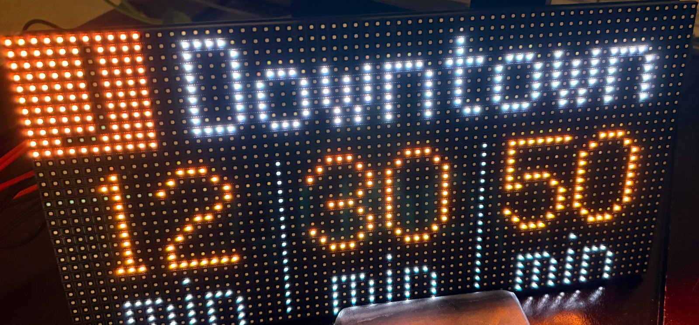

# muni_sign

A home arrival board for San Francisco Muni. A Raspberry Pi drives a 64×32 RGB LED panel
that shows when the next three trains arrive at your stop, using real-time predictions
from the [511.org Open Data API](https://511.org/open-data/transit).



- The text rotates between **Korean, Portuguese, Spanish and English** every 8 seconds.
  The numbers stay the same in every language, so anyone can read the times at a glance.
- Built to be **trusted**, including by elderly neighbours:
  - Minutes are rounded **down**, like Muni's own signs, so it never says a train is further
    away than it is.
  - If no fresh data has arrived for 3 minutes, or the Pi's clock disagrees with 511's server
    by more than 60 seconds, the times are **hidden** ("No data") instead of guessed.
  - Each prediction is classified as GPS-tracked (a vehicle is assigned and recently reported
    its position) or schedule-only. `--print` mode marks schedule-only times with `~`.
  - 511 only returns the next three trains, so the board fetches again 20 seconds after a
    train's time passes, to keep three columns on screen and confirm the train has left.
  - Requests stay under 511's limit of 60 per hour (75-second refresh plus those extra
    fetches, with a hard cap of 58 per hour).

## Hardware

| Part | Used here |
|---|---|
| Computer | Raspberry Pi 5 (Raspberry Pi OS / Debian 13) |
| LED panel | P5 outdoor 64×32 HUB75 panel, **1/8 scan** (ICN2038S driver) |
| Adapter | [Adafruit RGB Matrix Bonnet](https://www.adafruit.com/product/3211) |
| Panel power | **5V 4A (or more) DC adapter** into the Bonnet's barrel jack, e.g. Adafruit #1466 |

> **Power:** the panel needs its own 5V supply plugged into the Bonnet's round barrel jack.
> The Pi's USB-C supply cannot power it. Without that supply the panel shows dim red only,
> with no green or blue. The Bonnet's green LED next to the jack shows the 5V is good.
> Many cheap "5V 4A" adapters can't actually deliver their rated current.

## Setup

On the Pi:

```bash
# 1. Get the code and the LED library (a separate GPL-2.0-or-later project)
git clone https://github.com/boavida3/muni_sign.git
cd muni_sign
git clone https://github.com/hzeller/rpi-rgb-led-matrix.git

# 2. Python environment with the library's bindings
python3 -m venv venv
venv/bin/pip install ./rpi-rgb-led-matrix

# 3. The library needs the Pi's onboard sound turned off:
#    add (or keep) this line in /boot/firmware/config.txt, then reboot
#    dtparam=audio=off

# 4. Private settings
cp .env.example .env
chmod 600 .env
nano .env          # add your 511 API key and your stop's 5-digit number
```

Get a free 511 API key at https://511.org/open-data/token. The stop number is printed on
the Muni stop sign; each direction has its own number.

### Test

```bash
# Without the panel: prints what the board would show (no sudo needed)
venv/bin/python muni_board.py --print

# On the panel (needs root for hardware access); Ctrl+C to stop
sudo venv/bin/python muni_board.py
```

### Run at boot

```bash
sed "s|/home/pi/muni_sign|$PWD|g" muni-board.service | sudo tee /etc/systemd/system/muni-board.service
sudo systemctl enable --now muni-board
```

| To… | Run |
|---|---|
| Restart after editing the code | `sudo systemctl restart muni-board` |
| Stop it (e.g. to run something else on the panel) | `sudo systemctl stop muni-board` |
| Watch its log | `journalctl -u muni-board -f` |

Only one program can drive the panel at a time. While the service is running, don't start
`muni_board.py` by hand: the second copy hangs in hardware setup and ignores Ctrl+C.

## Configuration

Settings are at the top of `muni_board.py`: the line (`LINE`), refresh rate, language timing,
arrow direction (`ARROW = "left"`, `"right"` or `None`), an optional screen showing a GitHub URL (`GITHUB_USER`, off by default),
colours, brightness, and all the text for each language (`LANGUAGES`).

Panel options in `Panel.__init__` are set for this specific panel:
`rows=32, cols=64, hardware_mapping="adafruit-hat", gpio_slowdown=3, multiplexing=1`.
1/8-scan outdoor panels need a `multiplexing` mapping. If your panel looks scrambled, try
the library's other `--led-multiplexing` values.

## Licence and credits

- This project: **GPL-3.0** (see `LICENSE`).
- [rpi-rgb-led-matrix](https://github.com/hzeller/rpi-rgb-led-matrix) by Henner Zeller,
  GPL-2.0-or-later (cloned separately, not included here).
- [Galmuri](https://github.com/quiple/galmuri) pixel fonts by Lee Minseo, SIL Open Font
  License 1.1 (`fonts/`, licence in `fonts/Galmuri-LICENSE.txt`). Used for Korean text.
- Real-time data: [511.org Open Data](https://511.org/open-data). Predictions are estimates;
  always allow a little extra time.
